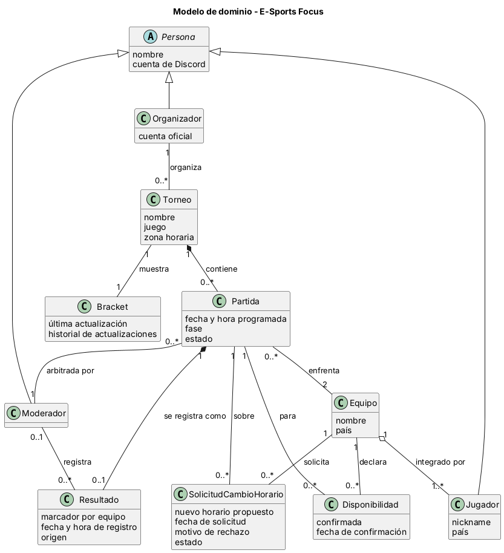

# Modelo de dominio

## Diagrama

Archivo fuente: [`./diagramas/modelo-dominio.puml`](./diagramas/modelo-dominio.puml)

## Descripción de las clases

| Clase | Qué representa en el negocio | Atributos |
|---|---|---|
| Persona | Cualquier persona que participa en el torneo. Es la clase base de los roles Jugador, Moderador y Organizador. | nombre, cuenta de Discord |
| Jugador | Integrante de un equipo que compite en las partidas. | nickname, país |
| Moderador | Persona que arbitra las partidas y registra resultados cuando la API no está disponible. | — |
| Organizador | Persona responsable de un torneo, que recibe resultados y anuncia ganadores. | cuenta oficial |
| Torneo | Campeonato de un videojuego, con sus partidas y su bracket. | nombre, juego, zona horaria |
| Partida | Enfrentamiento entre dos equipos dentro de un torneo. | fecha y hora programada, fase, estado |
| Equipo | Grupo de jugadores que compite como unidad. | nombre, país |
| Resultado | Marcador oficial de una partida, con su origen y su registro. | marcador por equipo, fecha y hora de registro, origen |
| Bracket | Vista del torneo que muestra las fases, los equipos y los resultados, y conserva el historial de sus actualizaciones. | última actualización, historial de actualizaciones |
| Disponibilidad | Confirmación de que un equipo puede jugar una partida. | confirmada, fecha de confirmación |
| SolicitudCambioHorario | Petición de un equipo para mover una partida a otro horario. | nuevo horario propuesto, fecha de solicitud, motivo de rechazo, estado |

## Asociaciones

La multiplicidad de cada extremo indica cuántas instancias de esa clase se relacionan con una instancia de la clase del otro extremo.

| Asociación | Clases | Multiplicidades | Justificación |
|---|---|---|---|
| organiza | Organizador — Torneo | 1 a 0..* | Un Organizador puede gestionar varios torneos; cada torneo tiene un Organizador. |
| contiene | Torneo — Partida | 1 a 0..* | Una partida pertenece a un único torneo (composición). |
| muestra | Torneo — Bracket | 1 a 1 | Cada torneo tiene un bracket que refleja sus resultados. |
| enfrenta | Partida — Equipo | 0..* a 2 | Cada partida enfrenta a dos equipos; un equipo juega varias partidas. |
| arbitrada por | Partida — Moderador | 0..* a 1 | Cada partida tiene un Moderador asignado; un Moderador arbitra varias partidas. |
| se registra como | Partida — Resultado | 1 a 0..1 | Una partida tiene como máximo un resultado registrado (composición). Mientras no existe, la partida está pendiente. |
| registra | Moderador — Resultado | 0..1 a 0..* | Un resultado manual lo registra un Moderador; un resultado automático no tiene Moderador. Un Moderador puede registrar varios resultados. |
| integrado por | Equipo — Jugador | 1 a 1..* | Un equipo está formado por al menos un jugador (agregación). Un jugador puede dejar de integrar un equipo sin que el jugador deje de existir. |
| declara | Equipo — Disponibilidad | 1 a 0..* | Cada equipo declara su disponibilidad para cada partida en la que participa. |
| para | Disponibilidad — Partida | 0..* a 1 | Cada registro de disponibilidad corresponde a una partida. |
| solicita | Equipo — SolicitudCambioHorario | 1 a 0..* | Cada solicitud de cambio la hace un equipo; un equipo puede hacer varias solicitudes. |
| sobre | Partida — SolicitudCambioHorario | 1 a 0..* | Una partida puede tener varias solicitudes de cambio a lo largo del tiempo. |

## Decisiones de modelado

- Jugador, Moderador y Organizador se modelaron como especializaciones de Persona (herencia), porque comparten datos básicos pero tienen información y permisos distintos (Entrevista 2, P11).
- Equipo agrega Jugadores (agregación) y no los compone, porque un jugador puede cambiar de equipo y seguir existiendo.
- Torneo compone Partida y Partida compone Resultado (composición), porque una partida no existe fuera de su torneo y un resultado no existe fuera de su partida.
- Disponibilidad se modeló como clase y no como atributo de Equipo, porque la disponibilidad cambia para cada partida. La disponibilidad es del equipo: la confirma un jugador en nombre del equipo, por lo que no se modela una confirmación por integrante.
- Quién registró un resultado se modeló como asociación Moderador — Resultado (y no como atributo), porque es una relación entre dos conceptos del negocio; en los resultados automáticos no hay Moderador.
- No se modelaron como clases los roles de Jugador "capitán" ni de "suplente", porque la Entrega 1 no los define. Queda como posible extensión si el equipo lo confirma.

