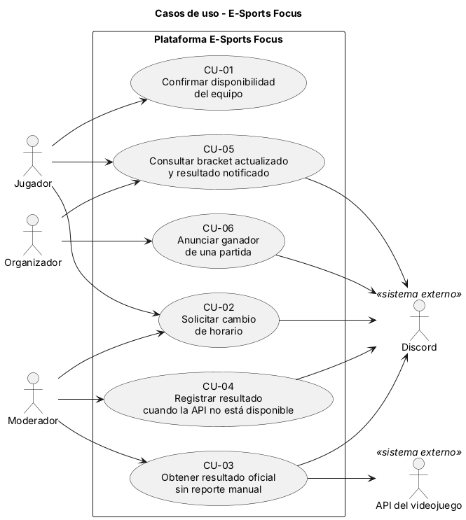

# Casos de uso

## Actores

| Actor | Tipo (humano / sistema externo) | Descripción |
|---|---|---|
| Jugador | Humano | Integrante de un equipo que compite en las partidas del torneo. |
| Moderador | Humano | Arbitra las partidas, aprueba cambios de horario y registra resultados cuando la API no está disponible. |
| Organizador | Humano | Gestiona el torneo, recibe los resultados y anuncia a los ganadores. |
| API del videojuego | Sistema externo | Entrega el resultado oficial de una partida finalizada. |
| Discord | Sistema externo | Canal donde se publican avisos, notificaciones y anuncios del torneo. |

## Diagrama de casos de uso

Archivo fuente: [`./diagramas/casos-de-uso.puml`](./diagramas/casos-de-uso.puml)

## Casos de uso y su origen

| ID | Caso de uso (objetivo del actor) | Actor principal | Historia de origen |
|---|---|---|---|
| CU-01 | Confirmar la disponibilidad del equipo para una partida | Jugador | [HU-04](./07-criterios-aceptacion.md) |
| CU-02 | Solicitar un cambio de horario de una partida | Jugador | [HU-05](./07-criterios-aceptacion.md) |
| CU-03 | Obtener el resultado oficial de una partida sin reporte manual | Moderador | [HU-01](./07-criterios-aceptacion.md) |
| CU-04 | Registrar el resultado de una partida cuando la API no está disponible | Moderador | [HU-03](./07-criterios-aceptacion.md) |
| CU-05 | Consultar el bracket actualizado y el resultado notificado | Jugador | [HU-02](./07-criterios-aceptacion.md) |
| CU-06 | Anunciar al ganador de una partida | Organizador | [HU-06](./07-criterios-aceptacion.md) |

Las historias HU-01 a HU-03 están definidas en [Historias de usuario (Entrega 1)](./Historias_de_usuario.md); sus criterios de aceptación en Gherkin están en [07-criterios-aceptacion.md](./07-criterios-aceptacion.md).

## Actores secundarios por caso de uso

| ID | Actor secundario | Participación |
|---|---|---|
| CU-02 | Moderador, Discord | El Moderador recibe la solicitud y la aprueba o rechaza; Discord recibe el aviso de la solicitud y del nuevo horario. |
| CU-03 | API del videojuego, Discord | La API entrega el resultado de la partida; Discord recibe el aviso del resultado y del bracket actualizado. |
| CU-04 | Discord | Recibe la notificación del resultado registrado manualmente. |
| CU-05 | Organizador, Discord | El Organizador recibe la notificación; Discord recibe el aviso del bracket actualizado. |
| CU-06 | Discord | Recibe el anuncio del ganador en el canal del torneo. |

## Relaciones entre casos de uso

- No se usaron relaciones `<<include>>` ni `<<extend>>`.
- CU-06 no es una extensión opcional de CU-03 ni de CU-04: el anuncio del ganador ocurre siempre que el resultado queda confirmado, sea por la API (CU-03) o por registro manual (CU-04). Por eso se mantiene como caso de uso propio del Organizador, activado por el resultado confirmado. Su flujo se muestra en [DSS-01](./10-diagramas-secuencia.md) y [DSS-02](./10-diagramas-secuencia.md).
- Tampoco se usó `<<include>>`, porque el anuncio es un objetivo propio del Organizador y no un paso interno de los casos de uso que registran el resultado.

