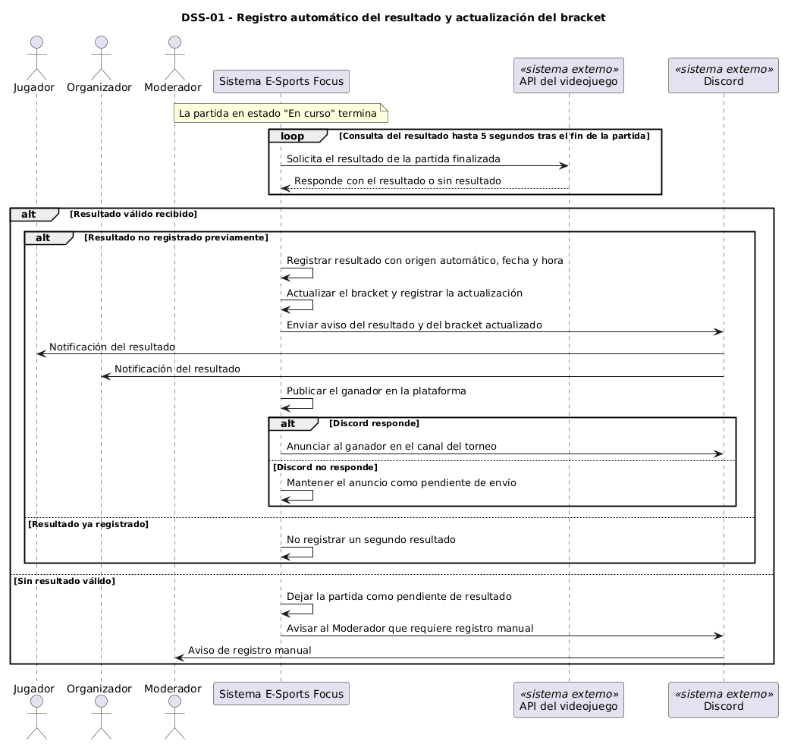
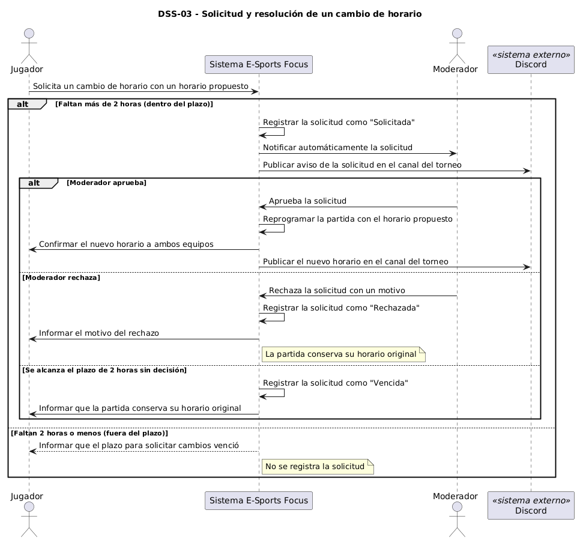
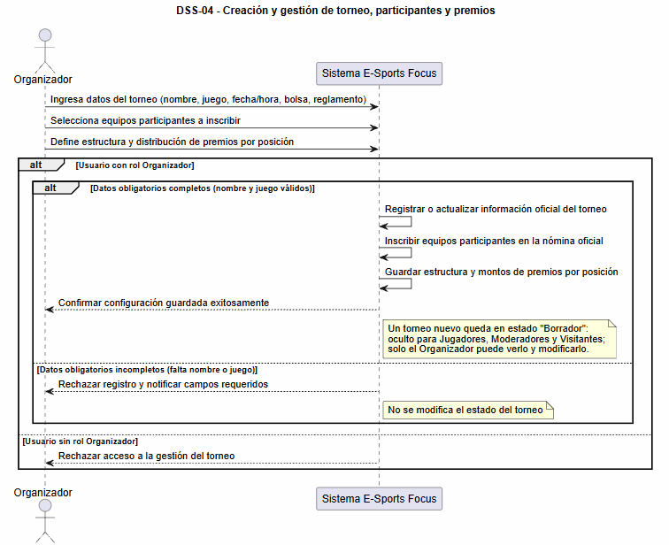
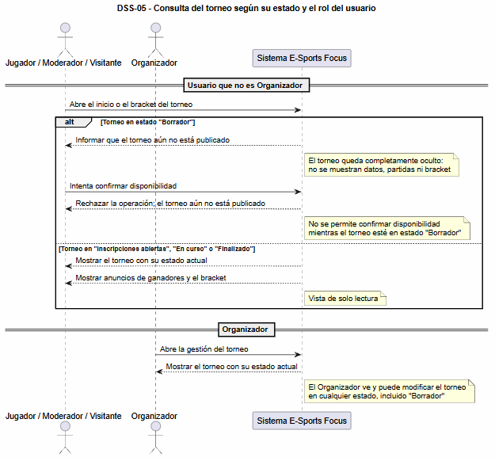

# Diagramas de secuencia de sistema

Cada diagrama muestra el sistema como caja negra. Los sistemas externos (API del videojuego y Discord) aparecen como participantes. Los mensajes usan el vocabulario del [modelo de dominio](./08-modelo-dominio.md).

## DSS-01 — Registro automático del resultado y actualización del bracket

- Caso de uso: [CU-03](./09-casos-de-uso.md) y [CU-06](./09-casos-de-uso.md)
- Historia: [HU-01](./07-criterios-aceptacion.md), [HU-02](./07-criterios-aceptacion.md) y [HU-06](./07-criterios-aceptacion.md)
- Sistemas externos que participan: API del videojuego, Discord

Archivo fuente: [`./diagramas/dss-01.puml`](./diagramas/dss-01.puml)

Variantes representadas:

- **loop:** el sistema consulta a la API del videojuego durante el plazo de detección de 5 segundos tras el fin de la partida (RP-08).
- **alt — resultado válido:** si la API entrega un resultado válido, se distinguen dos casos:
  - **alt anidado — resultado no registrado previamente:** el sistema registra el resultado con origen automático, actualiza el bracket (y registra la actualización, RP-10), notifica al Organizador y a los Jugadores, publica el ganador en la plataforma y lo anuncia en Discord (HU-06). Si Discord responde, el anuncio se envía; si no responde, el ganador queda publicado y el anuncio queda pendiente de envío.
  - **alt anidado — resultado ya registrado:** el sistema no crea un segundo resultado (HU-01, escenario "Un resultado ya registrado no se duplica").
- **alt — sin resultado válido:** si la API no entrega un resultado válido dentro del plazo de detección, la partida queda pendiente y se avisa al Moderador para el registro manual.

DSS-02 — Registro manual del resultado cuando la API no está disponible
- Caso de uso: [CU-04](./09-casos-de-uso.md) y [CU-06](./09-casos-de-uso.md)
- Historia: [HU-03](./07-criterios-aceptacion.md), [HU-02](./07-criterios-aceptacion.md), [HU-06](./07-criterios-aceptacion.md) y [HU-10](./07-criterios-aceptacion.md)
- Requisito: [RP-05](./Clasificación_de_requisitos.md) y [RP-12](./Clasificación_de_requisitos.md)
- Sistemas externos que participan: Discord

Variantes representadas:

- alt — torneo en curso: el registro manual solo se permite cuando el torneo está en estado "En curso" (RP-12).
- alt — Moderador asignado: solo el Moderador asignado a la partida puede registrar el resultado. Si no está asignado, la operación se rechaza y el resultado no cambia (HU-03).
- alt anidado — resultado completo: el registro requiere el resultado de ambos equipos. Si es incompleto, el sistema solicita completarlo.
- alt — torneo no está en curso ("Borrador", "Inscripciones abiertas" o "Finalizado"): el sistema rechaza el registro e informa que el torneo no está en curso; el resultado y la partida no cambian (Evaluación 2).
- Trazabilidad: el resultado se guarda con la identidad del Moderador, la fecha, la hora y el origen manual (RP-10). Al confirmarse, el sistema actualiza el bracket, notifica al Organizador y a los Jugadores, publica el ganador y lo anuncia en Discord. Si Discord no responde, el ganador queda publicado y el anuncio queda pendiente de envío.
- La API del videojuego no participa en este diagrama: su falta de resultado válido es la condición de partida (partida en estado "Pendiente de resultado").

## DSS-03 — Solicitud y resolución de un cambio de horario

- Caso de uso: [CU-02](./09-casos-de-uso.md)
- Historia: [HU-05](./07-criterios-aceptacion.md)
- Sistemas externos que participan: Discord

Archivo fuente: [`./diagramas/dss-03.puml`](./diagramas/dss-03.puml)

Variantes representadas:

- **alt — dentro del plazo (más de 2 horas antes):** la solicitud queda como "Solicitada", se notifica automáticamente al Moderador (RP-03) y se publica un aviso en el canal de Discord.
  - **alt — aprobada:** el Moderador aprueba, la partida se reprograma, ambos equipos reciben la confirmación y se publica el nuevo horario en Discord.
  - **alt — rechazada:** el Moderador rechaza con un motivo, la solicitud queda "Rechazada", la partida conserva su horario original y el equipo recibe el motivo.
  - **alt — vencida:** si se alcanza el plazo de 2 horas sin decisión del Moderador, la solicitud queda "Vencida" y la partida conserva su horario original.
- **alt — fuera del plazo (2 horas o menos antes):** el sistema no registra la solicitud e informa que el plazo venció.

DSS-04 — Creación y gestión de torneo, participantes y premios
- Caso de uso: [CU-09](./09-casos-de-uso.md)
- Historia: [HU-09](./07-criterios-aceptacion.md) y [HU-10](./07-criterios-aceptacion.md)
- Requisito: [RP-11](./Clasificación_de_requisitos.md) y [RP-12](./Clasificación_de_requisitos.md)
- Actor: Organizador

Variantes representadas:

- alt — usuario con rol Organizador: solo el Organizador puede crear y configurar el torneo (HU-10, CA2).
- alt anidado — datos obligatorios completos (nombre y juego válidos): el sistema registra o actualiza la información oficial del torneo, inscribe los equipos participantes en la nómina oficial, guarda la escala de premios desglosada por posición y confirma la operación al Organizador. Un torneo nuevo queda en estado "Borrador", oculto para Jugadores, Moderadores y Visitantes: solo el Organizador puede verlo y modificarlo (HU-10, CA1).
- alt anidado — datos obligatorios incompletos (falta nombre o juego): el sistema rechaza el guardado e informa los campos requeridos, sin modificar los datos ni el estado del torneo.
- alt — usuario sin rol Organizador: el sistema rechaza el acceso a la gestión del torneo.

DSS-05 — Consulta del torneo según su estado y el rol del usuario
- Caso de uso: [CU-07](./09-casos-de-uso.md), [CU-08](./09-casos-de-uso.md) y [CU-10](./09-casos-de-uso.md)
- Historia: [HU-07](./07-criterios-aceptacion.md), [HU-08](./07-criterios-aceptacion.md) y [HU-10](./07-criterios-aceptacion.md)
- Requisito: [RP-07](./Clasificación_de_requisitos.md) y [RP-12](./Clasificación_de_requisitos.md)
- Actores: Jugador, Moderador, Visitante y Organizador

Variantes representadas:

- alt — torneo en "Borrador" (usuario que no es Organizador): el torneo queda completamente oculto para Jugadores, Moderadores y Visitantes; el sistema informa que aún no está publicado y no muestra datos, partidas ni bracket (HU-10, CA1).
- alt — torneo publicado ("Inscripciones abiertas", "En curso" o "Finalizado"): el sistema muestra el torneo con su estado actual, los anuncios de ganadores y el bracket, en vista de solo lectura (HU-07 y HU-08).
- Organizador: ve y puede modificar el torneo en cualquier estado, incluido "Borrador" (HU-10, CA1 y CA2).
