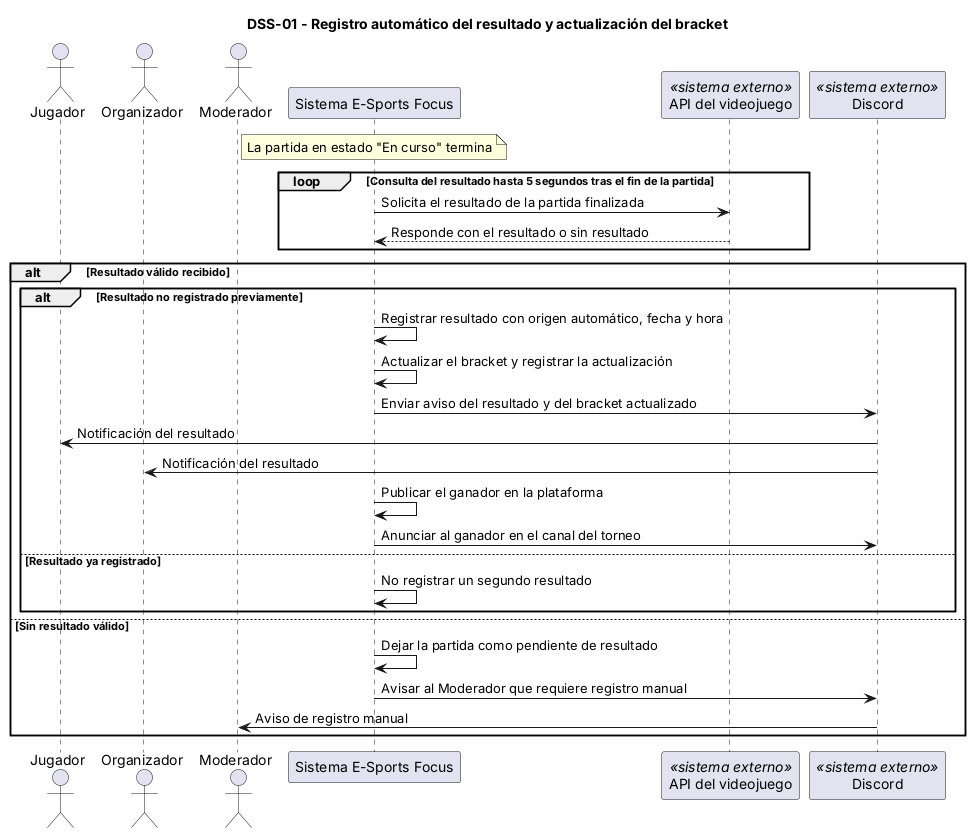
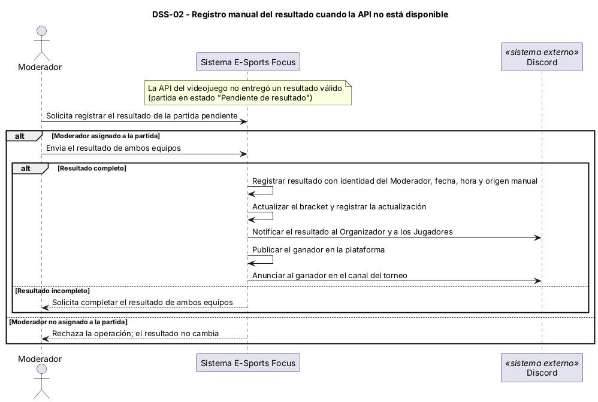
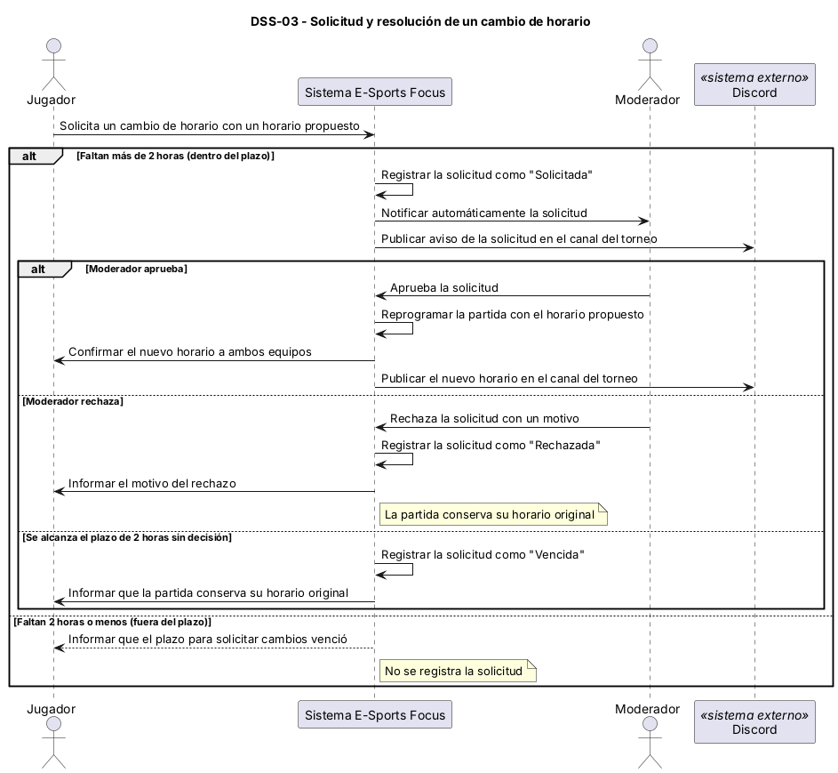

# Diagramas de secuencia de sistema

Cada diagrama muestra el sistema como caja negra. Los sistemas externos (API del videojuego y Discord) aparecen como participantes. Los mensajes usan el vocabulario del [modelo de dominio](./08-modelo-dominio.md).

## DSS-01 — Registro automático del resultado y actualización del bracket

- Caso de uso: [CU-03](./09-casos-de-uso.md) y [CU-06](./09-casos-de-uso.md)
- Historia: [HU-01](./07-criterios-aceptacion.md), [HU-02](./07-criterios-aceptacion.md) y [HU-06](./07-criterios-aceptacion.md)
- Sistemas externos que participan: API del videojuego, Discord

Archivo fuente: [`./diagramas/dss-01.puml`](./diagramas/dss-01.puml)

Variantes representadas:

- **loop:** el sistema consulta a la API del videojuego durante el plazo de detección de 5 segundos tras el fin de la partida (RP-08).
- **alt — resultado válido:** si la API entrega un resultado válido, se distinguen dos casos:
  - **alt anidado — resultado no registrado previamente:** el sistema registra el resultado con origen automático, actualiza el bracket (y registra la actualización, RP-10), notifica al Organizador y a los Jugadores, publica el ganador en la plataforma y lo anuncia en Discord (HU-06).
  - **alt anidado — resultado ya registrado:** el sistema no crea un segundo resultado (HU-01, escenario "Un resultado ya registrado no se duplica").
- **alt — sin resultado válido:** si la API no entrega un resultado válido dentro del plazo de detección, la partida queda pendiente y se avisa al Moderador para el registro manual.

## DSS-02 — Registro manual del resultado cuando la API no está disponible

- Caso de uso: [CU-04](./09-casos-de-uso.md) y [CU-06](./09-casos-de-uso.md)
- Historia: [HU-03](./07-criterios-aceptacion.md), [HU-02](./07-criterios-aceptacion.md) y [HU-06](./07-criterios-aceptacion.md)
- Sistemas externos que participan: Discord

Archivo fuente: [`./diagramas/dss-02.puml`](./diagramas/dss-02.puml)

Variantes representadas:

- **alt — Moderador asignado:** solo el Moderador asignado a la partida puede registrar el resultado. Si no está asignado, la operación se rechaza y el resultado no cambia (HU-03).
- **alt anidado — resultado completo:** el registro requiere el resultado de ambos equipos. Si es incompleto, el sistema solicita completarlo.
- **Trazabilidad:** el resultado se guarda con la identidad del Moderador, la fecha, la hora y el origen manual (RP-10). Al confirmarse, el sistema actualiza el bracket, notifica al Organizador y a los Jugadores, publica el ganador y lo anuncia en Discord.
- La API del videojuego no participa en este diagrama: su falta de resultado válido es la condición de partida (partida en estado "Pendiente de resultado").

## DSS-03 — Solicitud y resolución de un cambio de horario

- Caso de uso: [CU-02](./09-casos-de-uso.md)
- Historia: [HU-05](./07-criterios-aceptacion.md)
- Sistemas externos que participan: Discord

Archivo fuente: [`./diagramas/dss-03.puml`](./diagramas/dss-03.puml)

Variantes representadas:

- **alt — dentro del plazo (más de 2 horas antes):** la solicitud queda como "Solicitada", se notifica automáticamente al Moderador (RP-03) y se publica un aviso en el canal de Discord.
  - **alt — aprobada:** el Moderador aprueba, la partida se reprograma, ambos equipos reciben la confirmación y se publica el nuevo horario en Discord.
  - **alt — rechazada:** el Moderador rechaza con un motivo, la solicitud queda "Rechazada", la partida conserva su horario original y el equipo recibe el motivo.
  - **alt — vencida:** si se alcanza el plazo de 2 horas sin decisión del Moderador, la solicitud queda "Vencida" y la partida conserva su horario original.
- **alt — fuera del plazo (2 horas o menos antes):** el sistema no registra la solicitud e informa que el plazo venció.
