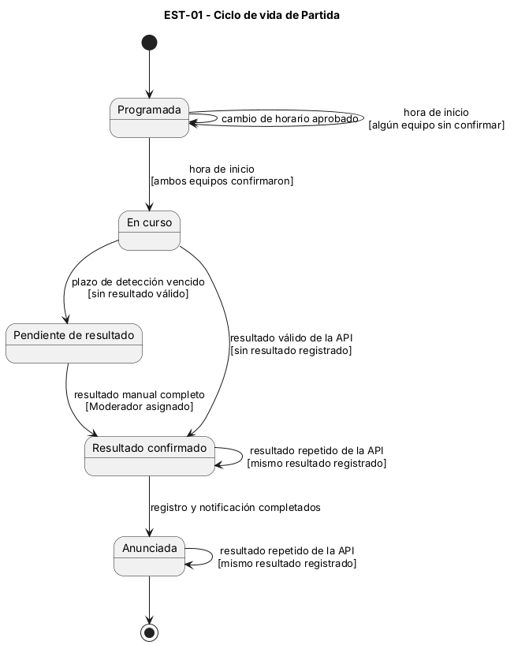
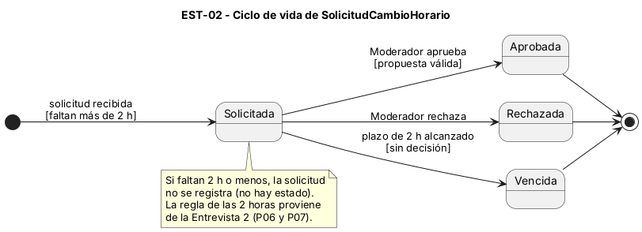

# Diagramas de estado

## EST-01 — Ciclo de vida de Partida

- Clase del dominio: [Partida](./08-modelo-dominio.md)
- Diagramas de secuencia relacionados: [DSS-01](./10-diagramas-secuencia.md), [DSS-02](./10-diagramas-secuencia.md)

Archivo fuente: [`./diagramas/est-01.puml`](./diagramas/est-01.puml)

Los estados son situaciones de la partida: Programada, En curso, Pendiente de resultado, Resultado confirmado y Anunciada.

### Tabla de transiciones

| Estado origen | Evento | Guarda | Acción | Estado destino |
|---|---|---|---|---|
| — (inicial) | Partida creada en el torneo | — | — | Programada |
| Programada | Cambio de horario aprobado | — | Actualizar fecha y hora de la partida | Programada |
| Programada | Hora de inicio alcanzada | Algún equipo sin confirmar disponibilidad | Marcar la partida para revisión del Moderador | Programada |
| Programada | Hora de inicio alcanzada | Ambos equipos confirmaron disponibilidad | Iniciar la partida | En curso |
| En curso | Resultado válido recibido de la API | No existe resultado registrado | Registrar resultado con origen automático; actualizar bracket; notificar | Resultado confirmado |
| En curso | Plazo de detección vencido | Sin resultado válido de la API | Dejar la partida pendiente y avisar al Moderador para el registro manual | Pendiente de resultado |
| Pendiente de resultado | Resultado completo registrado por el Moderador | Moderador asignado y resultado de ambos equipos | Registrar resultado con origen manual; actualizar bracket; notificar | Resultado confirmado |
| Resultado confirmado | Resultado repetido recibido de la API | Mismo resultado ya registrado | No registrar duplicado | Resultado confirmado |
| Resultado confirmado | Registro y notificación completados | — | Publicar el ganador en la plataforma y anunciarlo en Discord (si Discord no responde, el anuncio queda pendiente de envío) | Anunciada |
| Anunciada | Resultado repetido recibido de la API | Mismo resultado ya registrado | No registrar duplicado | Anunciada |
| Anunciada | — (final) | — | — | — (final) |

## EST-02 — Ciclo de vida de SolicitudCambioHorario

- Clase del dominio: [SolicitudCambioHorario](./08-modelo-dominio.md)
- Diagramas de secuencia relacionados: [DSS-03](./10-diagramas-secuencia.md)

Archivo fuente: [`./diagramas/est-02.puml`](./diagramas/est-02.puml)

Los estados son situaciones de la solicitud: Solicitada, Aprobada, Rechazada y Vencida. Una solicitud recibida con 2 horas o menos de anticipación no se registra, por lo que no tiene estado (HU-05).

### Tabla de transiciones

| Estado origen | Evento | Guarda | Acción | Estado destino |
|---|---|---|---|---|
| — (inicial) | Solicitud de cambio recibida | Faltan más de 2 horas para la partida | Registrar la solicitud, notificar al Moderador y publicar el aviso en Discord | Solicitada |
| Solicitada | Moderador aprueba la solicitud | Propuesta válida | Reprogramar la partida, confirmar el nuevo horario a ambos equipos y publicarlo en Discord | Aprobada |
| Solicitada | Moderador rechaza la solicitud | — | Informar el motivo del rechazo al equipo; la partida conserva su horario | Rechazada |
| Solicitada | Plazo límite alcanzado (2 horas antes de la partida) | Sin decisión del Moderador | Mantener el horario original e informar al equipo | Vencida |
| Aprobada | — (final) | — | — | — (final) |
| Rechazada | — (final) | — | — | — (final) |
| Vencida | — (final) | — | — | — (final) |

*La regla de las 2 horas proviene de la Entrevista 2 (P06 y P07). Debe validarse con el Moderador antes de dar la especificación por cerrada.*

