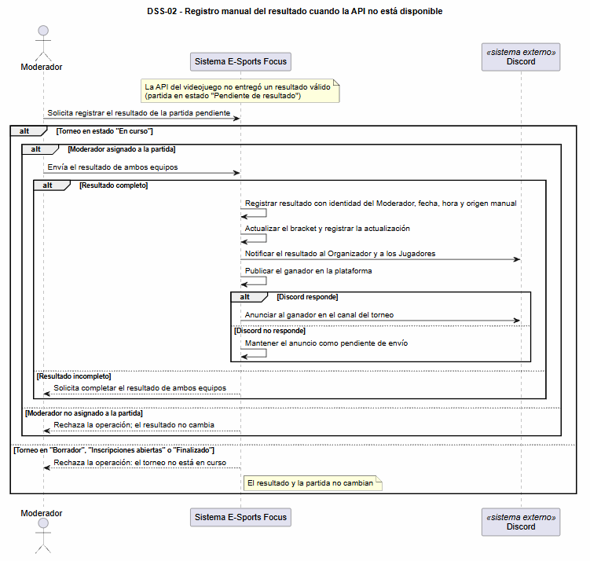
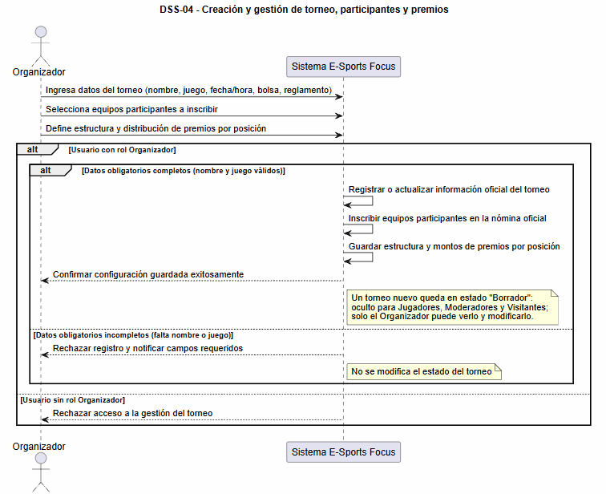
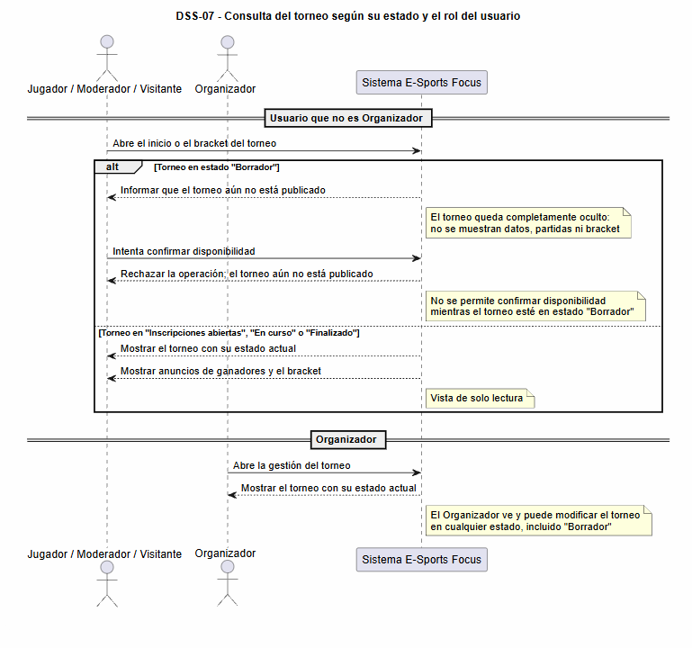

# Propuesta de solución para la Evaluacion 2

## Lo que se debe de hacer 
Los estados del torneo hoy no tienen lógica asociada: no hay reglas especificadas sobre qué se puede hacer en cada estado. Por ejemplo, en un torneo en estado «borrador» los jugadores no deben poder confirmar disponibilidad ni ingresar resultados.

Debe especificarse e implementarse este control de estados, incluyendo el diagrama de estados, el modelo de dominio y las HU con sus criterios de aceptación.

Debe poder verse: El estado de los torneos.

## Solución

Se nos pidió modificar el comportamiento de los estados de un torneo, ya que el torneo al estar en borrador, los jugadores puedes seguir accediendo a el y modificar su estado, debiendo ser exclusivamente para el organizador. Debido a esto decidimos agregar una nueva historia de usuario haciendo que esto nos haga unos cambio en los siguientes apartados:

- modificar el diagrama de estado
- clasificación de requerimientos
- modelo de dominio
- diagrama de secuencia
- casos de uso
- la trazabilidad

En algunos apartados tendran cambios diminutos pero en otros seran un poco mas extensos debido al cambio que se nos pide.

## HU-10: Estado Torneo - Interacción Organizador/Usuario 
Como organizador de torneos me gustaría tener control total sobre la edición y estados del torneo, estos permisos deben ser exclusivamente del rol “Organizador/a”.

**Criterios de aceptación:**
- CA1: El sistema no deberá mostrar al usuario en ningún caso un torneo que aun no este en curso.
- CA2: El organizador/a debe poder alternar estados entre torneos y tener acceso a modificarlos

## HU-10 - Gherkin

## Casos de uso
Para cubrir **HU-10** sin crear un caso de uso nuevo (ya que el formulario tiene el selector de estado), actualizamos `09-caso-de-uso.md` con estos cambios:
* **CU-01 (Confirmar disponibilidad):** Se agrega la precondición de que el torneo no este en `Borrador` (debe estar en `En curso`) y el rechazo si está en borardor.
* **CU-04 (Registrar resultado):** Se exige que el torneo no esté en `Borrador` (debe estar en `En curso`) y se bloquea el registro si está en borrador.
* **CU-09 (Gestionar torneo):** Se suma la acción de cambiar el estado del torneo (`Borrador`, `Inscripciones abiertas`, `En curso` y `Finalizado`), exclusiva del **Organizador**, dejando el estado visible en la plataforma

## Modelo de dominio

## Clasificación de requisitos 

## Diagrama de estado

## Diagrama de secuencia 

-----------------------------------------------------------------------------------------------------------------------------------------------------------------------------------------------------------
[DSS-02 — Registro manual del resultado cuando la API no está disponible
- Caso de uso: [CU-04](./09-casos-de-uso.md) y [CU-06](./09-casos-de-uso.md)
- Historia: [HU-03](./07-criterios-aceptacion.md), [HU-02](./07-criterios-aceptacion.md), [HU-06](./07-criterios-aceptacion.md) y [HU-10](./07-criterios-aceptacion.md)
- Requisito: [RP-05](./Clasificación_de_requisitos.md) y [RP-12](./Clasificación_de_requisitos.md)
- Sistemas externos que participan: Discord

Variantes representadas:

- alt — torneo en curso: el registro manual solo se permite cuando el torneo está en estado "En curso" (RP-12).
- alt — Moderador asignado: solo el Moderador asignado a la partida puede registrar el resultado. Si no está asignado, la operación se rechaza y el resultado no cambia (HU-03).
- alt anidado — resultado completo: el registro requiere el resultado de ambos equipos. Si es incompleto, el sistema solicita completarlo.
- alt — torneo no está en curso ("Borrador", "Inscripciones abiertas" o "Finalizado"): el sistema rechaza el registro e informa que el torneo no está en curso; el resultado y la partida no cambian (Evaluación 2).
- Trazabilidad: el resultado se guarda con la identidad del Moderador, la fecha, la hora y el origen manual (RP-10). Al confirmarse, el sistema actualiza el bracket, notifica al Organizador y a los Jugadores, publica el ganador y lo anuncia en Discord. Si Discord no responde, el ganador queda publicado y el anuncio queda pendiente de envío.
- La API del videojuego no participa en este diagrama: su falta de resultado válido es la condición de partida (partida en estado "Pendiente de resultado").]

[DSS-04 — Creación y gestión de torneo, participantes y premios
- Caso de uso: [CU-09](./09-casos-de-uso.md)
- Historia: [HU-09](./07-criterios-aceptacion.md) y [HU-10](./07-criterios-aceptacion.md)
- Requisito: [RP-11](./Clasificación_de_requisitos.md) y [RP-12](./Clasificación_de_requisitos.md)
- Actor: Organizador

Variantes representadas:

- alt — usuario con rol Organizador: solo el Organizador puede crear y configurar el torneo (HU-10, CA2).
- alt anidado — datos obligatorios completos (nombre y juego válidos): el sistema registra o actualiza la información oficial del torneo, inscribe los equipos participantes en la nómina oficial, guarda la escala de premios desglosada por posición y confirma la operación al Organizador. Un torneo nuevo queda en estado "Borrador", oculto para Jugadores, Moderadores y Visitantes: solo el Organizador puede verlo y modificarlo (HU-10, CA1).
- alt anidado — datos obligatorios incompletos (falta nombre o juego): el sistema rechaza el guardado e informa los campos requeridos, sin modificar los datos ni el estado del torneo.
- alt — usuario sin rol Organizador: el sistema rechaza el acceso a la gestión del torneo.]

[DSS-07 — Consulta del torneo según su estado y el rol del usuario
- Caso de uso: [CU-07](./09-casos-de-uso.md), [CU-08](./09-casos-de-uso.md) y [CU-10](./09-casos-de-uso.md)
- Historia: [HU-07](./07-criterios-aceptacion.md), [HU-08](./07-criterios-aceptacion.md) y [HU-10](./07-criterios-aceptacion.md)
- Requisito: [RP-07](./Clasificación_de_requisitos.md) y [RP-12](./Clasificación_de_requisitos.md)
- Actores: Jugador, Moderador, Visitante y Organizador

Variantes representadas:

- alt — torneo en "Borrador" (usuario que no es Organizador): el torneo queda completamente oculto para Jugadores, Moderadores y Visitantes; el sistema informa que aún no está publicado y no muestra datos, partidas ni bracket (HU-10, CA1).
- alt — torneo publicado ("Inscripciones abiertas", "En curso" o "Finalizado"): el sistema muestra el torneo con su estado actual, los anuncios de ganadores y el bracket, en vista de solo lectura (HU-07 y HU-08).
- Organizador: ve y puede modificar el torneo en cualquier estado, incluido "Borrador" (HU-10, CA1 y CA2).]

-----------------------------------------------------------------------------------------------------------------------------------------------------------------------------------------------------------
## Trazabilidad
