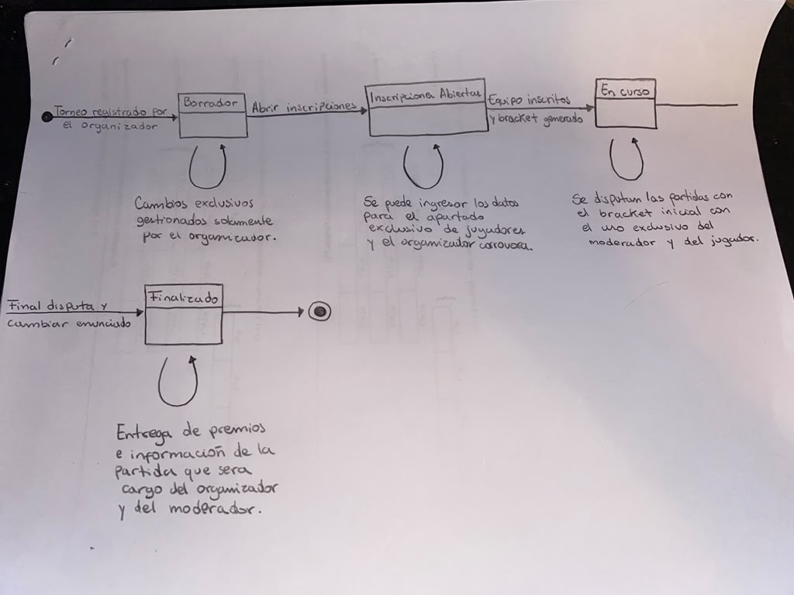

# Propuesta de solución para la Evaluacion 2

## Lo que se debe de hacer 
Los estados del torneo hoy no tienen lógica asociada: no hay reglas especificadas sobre qué se puede hacer en cada estado. Por ejemplo, en un torneo en estado «borrador» los jugadores no deben poder confirmar disponibilidad ni ingresar resultados.

Debe especificarse e implementarse este control de estados, incluyendo el diagrama de estados, el modelo de dominio y las HU con sus criterios de aceptación.

Debe poder verse: El estado de los torneos.

## Solución

Se nos pidio modificar el comportamiento de los estados de un torneo, ya que el torneo al estar en borrador los jugadores puedes seguir accediendo a el y modificar su estado, debido a esto decidimos unicamente modificar el "Diagrama de estado" ya que dentro de nuestra app ya tenemos una etiqueta dedicada a al estado del torneo sea "Borrador" "Inscripcion abierta" entre otros pero estos seran los principales, al modificar el diagrama de estado modificaremos el como se comporta dentro del sistema delimitando que al estar en estado "borrador" unicamente el organizador pueda tener acceso a ella.

Lo que haremos es cambiar el diagrama de estado en la parte de EST-03 que es el ciclo de vida del torneo, agregar o modificar que sean necesarias y agregar la clasificación de requisitos. 

## HU-NEW: Estado Torneo - Interacción Organizador/Usuario 
Como organizador de torneos me gustaría tener control total sobre la edición y estados del torneo, estos permisos deben ser exclusivamente del rol “Organizador/a”.

**Criterios de aceptación:**
- CA1: El sistema muestra el estado actual del torneo, ocultando completamente el apartado de Borrador para los usuario menos para el Organizador.
- CA2: El organizador/a debe poder alternar estados entre torneos y tener acceso a modificarlos

## Clasificación de requisitos 

**Diagrama de estado**

